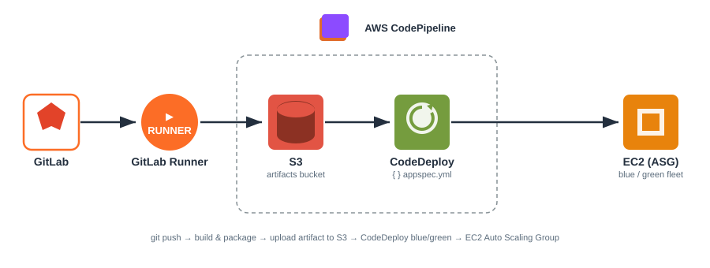

# AWS Blue/Green CI/CD Automation

Infrastructure and deployment automation for a production web application on AWS, built around **AWS CodeDeploy blue/green deployments**, an **Auto Scaling Group with mixed instances (Graviton + x86, On-Demand + Spot)**, and a **GitLab CI → S3 → CodeDeploy** artifact pipeline.

> All environment-specific identifiers (account IDs, bucket names, load balancer names, instance IDs) have been replaced with generic placeholders.

## Architecture Overview



**Flow:** a `git push` to GitLab triggers the GitLab Runner (self-hosted on EC2), which builds and packages the app, then uploads the artifact to **Amazon S3**. **AWS CodeDeploy** pulls that artifact and runs a **blue/green** deployment — provisioning a new green fleet by copying the Auto Scaling Group, shifting ALB traffic to it, and terminating the old blue fleet after success.

## CI/CD Pipeline

The pipeline does **not** use CodeDeploy's native Git integration. Instead it follows an S3-based pattern:

1. **GitLab CI** builds the application artifact.
2. The artifact is zipped and uploaded to an S3 bucket (`<artifacts-bucket>`).
3. **CodeDeploy** pulls the artifact from S3 and runs the deployment.

**Artifact naming convention:**

```
app-srv-<build_number>-<timestamp>.zip
```

## Deployment Strategy — CodeDeploy Blue/Green

- **Deployment config:** `CodeDeployDefault.AllAtOnce`
- **Traffic control:** Application Load Balancer (ALB) shifts traffic from the blue fleet to the green fleet.
- **Green fleet provisioning:** created by copying the existing Auto Scaling Group.
- **Blue fleet termination:** terminated immediately after a successful deployment (0-minute wait).

## Auto Scaling Group — Mixed Instances + Spot

A mixed-instances ASG spread across all three Availability Zones (`1a`, `1b`, `1c`).

| Setting | Value |
|---|---|
| Max capacity | 18 instances |
| Spot allocation strategy | `price-capacity-optimized` |
| On-Demand base capacity | 1 instance |
| On-Demand above base | 30% |
| Remaining capacity | Spot |

**Spot allocation strategy:** `price-capacity-optimized` — AWS selects the capacity pool with the most available capacity at the best price, reducing interruption risk.

### Instance mix

The fleet combines **Graviton (ARM)** and **x86** instance families for cost efficiency and capacity diversity:

- **Graviton:** `c7g.2xlarge`
- **x86:** `c5`, `c4`, `c7i`, `m5a` families

Diversifying across many instance types widens the Spot capacity pools AWS can draw from, improving availability and reducing interruptions.

## Scaling Policy — Target Tracking

Scaling is driven by a **Target Tracking** policy:

- **Metric:** ALB requests per target
- **Target value:** ~1,900 requests per target
- **Target resource:** application load balancer (`<app-load-balancer>`)

The ASG scales out when average requests per target exceed the target, and scales in when demand drops.

## Repository Structure

```
cicd-automation/
├── README.md                        # This document
├── appspec.yml                      # CodeDeploy lifecycle hook mapping
├── Asg-mixed-instance-policy.json   # ASG mixed-instances policy (Graviton + x86, Spot)
├── .gitlab-ci.yml                   # GitLab CI/CD pipeline (build → upload → deploy)
├── docs/
│   ├── architecture.svg             # Architecture diagram (official AWS Architecture Icons)
│   ├── codedeploy-setup.md          # AWS CodeDeploy blue/green configuration
│   └── gitlab-setup.md              # GitLab environments, CI/CD variables & runner setup
└── aws-cd/                          # CodeDeploy deployment lifecycle scripts
    ├── after_install.sh
    ├── application_start.sh
    ├── validate_service.sh
    ├── after_block_traffic.sh
    └── update_lifecycle_hook.sh
```

## Documentation

- [CodeDeploy Setup](docs/codedeploy-setup.md) — blue/green application, service role, and deployment group configuration.
- [GitLab Setup](docs/gitlab-setup.md) — environments, CI/CD variables (S3 credentials), and project runner registration on EC2.
- [GitLab Pipeline](.gitlab-ci.yml) — the CI/CD pipeline definition: build, upload, and deploy stages, including the `aws deploy push` to S3.

## Notes

- Keep account IDs, real bucket/ALB names, instance IDs, and credentials out of this repository.
- Store secrets in a secrets manager or CI/CD protected variables, never in source control.
